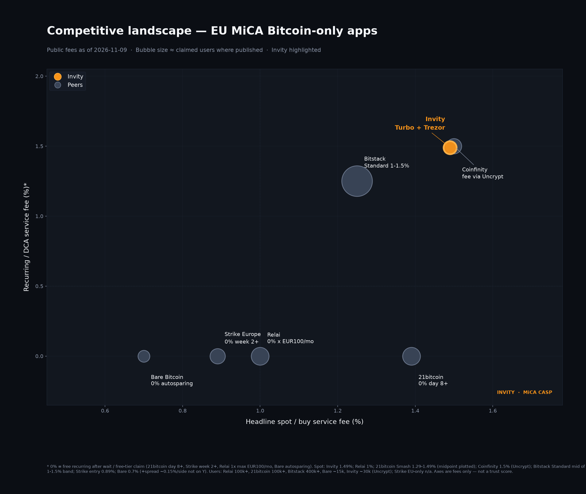
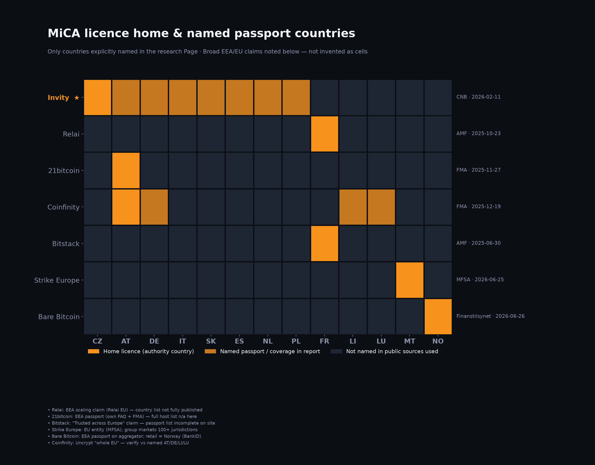
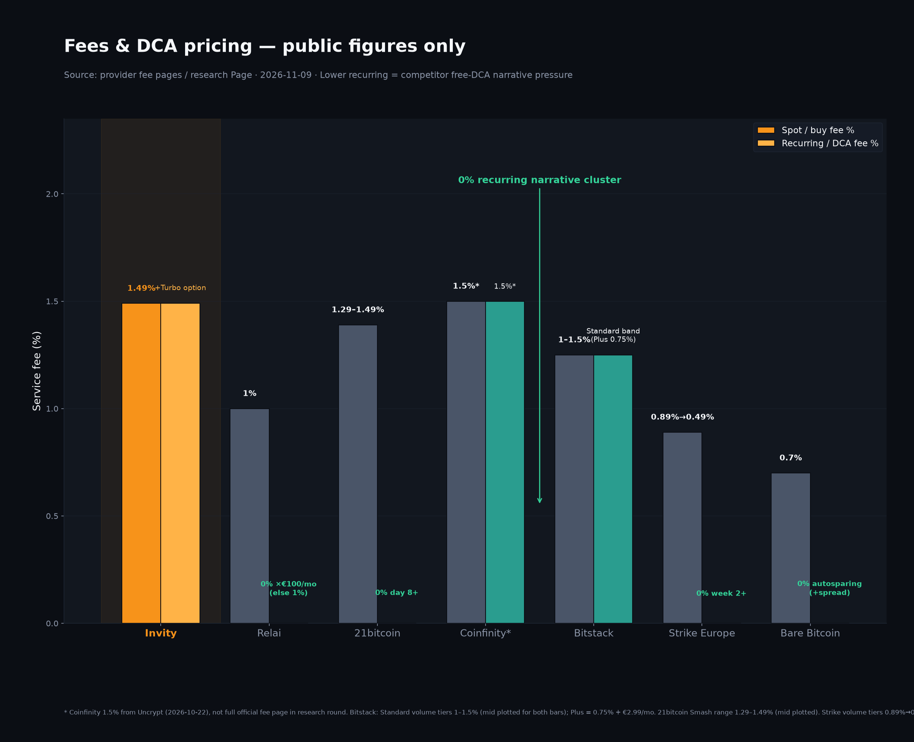
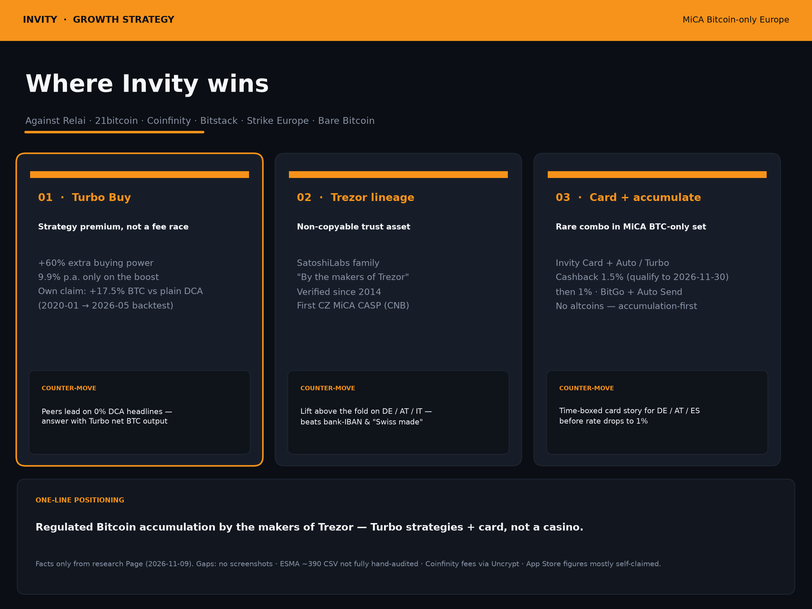

# Competitor pack and education research

_Archived from the v1.1.0 page (9 Nov 2026). Moved off the main page in v2.0.0 because a hiring manager does not need competitive charts or fee comparisons to judge an application. Not linked from the main navigation. Unverified or superseded statements are kept as they were; see the notes at the top._

> Caution: fee figures, peer data and chart values come from a 9 Nov 2026 research pass and were not re-verified for v2.0.0. Treat them as research notes, not facts for publication.

02d · Competitive context

## MiCA Bitcoin-only peers. Message, not roadmap.

Research pack dated **9 Nov 2026** (Europe/Budapest). Charts from the Market Researcher visual pack. Messaging / proof / channel only — no product roadmap asks.

Independent synthesis of public pages. Not an Invity competitive intelligence deliverable. Full caveats below and in COMPLIANCE.md.

**01 · Landscape.** Peers cluster on 0% recurring-fee narratives; Invity sits at a public **1.49%** service fee with Turbo as the strategy answer — not a fee-race win on headline DCA %. Bubble sizes ≈ claimed users where published.

**02 · Passport honesty.** Invity’s clearest public list: **CZ + AT, DE, IT, SK, ES, NL, PL**. Prefer naming the eight over vague “Europe” copy.

**03 · Fee pressure.** 0% DCA cluster: 21bitcoin (day 8+), Strike (week 2+), Relai (1×€100/mo), Bare (autosparing). Bridge immediately to Turbo net-BTC story — never leave the frame as “we lose on price.”

**04 · Where Invity wins.** Turbo Buy (+60% buying power; 9.9% p.a. only on the boost); Trezor / SatoshiLabs trust; Card + accumulation. Backtests are for existing-user education only — not cold acquisition promises.

### Five marketing counter-moves My inference from the research

1. **DCA fee fairness block** — show public % side by side, then Turbo mechanics (fees disclosed; no guaranteed outperformance in ads).
2. **Trezor proof above the fold** — especially DE/AT/IT: “By the makers of Trezor” with verifiable SatoshiLabs lineage.
3. **Self-custody parity** — Auto Send / hardware choice at equal visual weight to BitGo custody.
4. **Card + accumulation** — time-boxed cashback messaging only with current public terms and end date.
5. **Passport accuracy** — name CZ+7; don’t ape vague EEA claims.

### Data caveats (must travel with the charts)

* Full ESMA interim CASP CSV (~390+) was not hand-audited for every Bitcoin-only entity.
* Coinfinity fees partly from Uncrypt (2026-10-22); official full schedule not fully captured.
* App Store / Play ratings often self-claimed or aggregated, not live store scrapes.
* Strike Europe vs global Strike users not cleanly separated; Bare Bitcoin retail ≠ every passport country.
* Invity spread beside the 1.49% service fee not quantified in the research.
* Chart midpoints are visualisations of reported bands — see PNG footnotes.

Source research page: *Invity MiCA Bitcoin-only piackutatás*, 9 Nov 2026. Visual pack: `(local research folder) ` (copied to `assets/`).

---

02c · Education as the growth engine

## Teach first. Then invite the first buy.

Invity already ships education. Social’s job is to turn those assets into hooks, consent-based leads, and activation — not to invent a second curriculum.

### What already exists Public evidence

* **Invity Academy** — in-app bite-sized lessons, quizzes and frameworks. About page: “Get smarter about Bitcoin.” Timeline on About us places an educational Academy in the 2024 product era; a Czech Academy launch post is dated **18 Feb 2025** and describes short self-paced lessons spanning history of money, Bitcoin and blockchain, plus financial literacy (exact in-app lesson titles not published on the English site — **do not invent names**). invity.io/about-us · blog.invity.io Academy post, 18 Feb 2025
* **Blog** — product, strategy and education on [invity.io/blog](https://www.invity.io/blog/) (and the older blog.invity.io host). Directory hub: [How to Bitcoin](https://www.invity.io/blog/how-to-bitcoin-everything-you-wanted-to-know-about-crypto) (9 Jan 2025).
* **Newsletter · “Straight from Invity”** — regular Bitcoin, finance and Invity updates with explicit subscribe consent on About us. invity.io/about-us
* **eBook · “Broken Money and the Way Out”** — free ~50-page beginner guide; Invity Academy Volume 01; landing [/broken-money-and-the-way-out](https://www.invity.io/broken-money-and-the-way-out); PDF [download](https://www.invity.io/downloads/invity-broken-money-and-the-way-out.pdf).

### How social uses them

1. **Academy → content hooks.** One public question per week that a quiz or short lesson already answers; CTA is “open Academy in the app,” not a price tip.
2. **Quiz-to-lead.** After an educational Meta/X piece, offer the eBook or newsletter only with clear marketing consent (GDPR). Soft gate: email → PDF / newsletter, never a forced purchase.
3. **eBook as lead magnet.** Paid and organic point to the Broken Money landing; UTM’d; measure confirmed subscribers and later first purchases, not vanity downloads alone.
4. **Blog → carousel / thread.** One verified article becomes 5–7 slides or a thread (custody, seed phrases, phishing, first buy). Link the article; keep claims inside what the post says.
5. **Academy completion as activation metric.** Alongside first purchase: share of new sign-ups who finish at least one Academy path in 14 days. Needs internal data
6. **Newsletter as nurture.** “Straight from Invity” carries the monthly Ask Invity Live recap and One Question answers — permission-first frequency.

**What would change my mind:** Academy completion correlating poorly with first purchase after we have 90 days of cohorts — then education stays brand, not activation.

### Verified education hooks I would schedule (no invented lesson titles)

| Hook theme | Public asset | Social format |
| --- | --- | --- |
| History of money → why Bitcoin exists | eBook *Broken Money…* (parts I–II); Academy topic area “history of money” | Carousel + eBook CTA |
| How Bitcoin / blockchain / mining / fees work | [How to Bitcoin](https://www.invity.io/blog/how-to-bitcoin-everything-you-wanted-to-know-about-crypto) directory | X thread |
| Custody vs self-custody | [What is crypto custody](https://www.invity.io/blog/what-is-crypto-custody-and-why-is-it-important) | IG carousel |
| Recovery seed safety | [Seeds of security](https://www.invity.io/blog/seeds-of-security-an-introduction-to-recovery-seed-phrases) | Reels script |
| Phishing patterns | [5 types of phishing](https://www.invity.io/blog/how-to-identify-and-avoid-5-types-of-phishing-tactics) | Carousel |
| First purchase walkthrough | [Buying your first Bitcoin with Invity](https://www.invity.io/blog/buying-your-first-bitcoin-with-invity-2) | Under the Hood clip |
| MiCA / July 1, 2026 transition (fair, not scare) | [MiCA July 1, 2026 deadline](https://www.invity.io/blog/mica-july-2026-deadline-what-it-means-for-your-bitcoin) | X explainer + LinkedIn |
| Turbo risk literacy (existing users only) | [How to stay safe with Turbo Buy](https://www.invity.io/blog/how-to-stay-safe-with-turbo-buy) · Turbo fee post 13 Jun 2026 | In-app / CRM, not cold paid |

Academy in-app lesson titles are not listed on the public English site. Hooks use topic areas from the Academy launch description and named blog/eBook assets only.